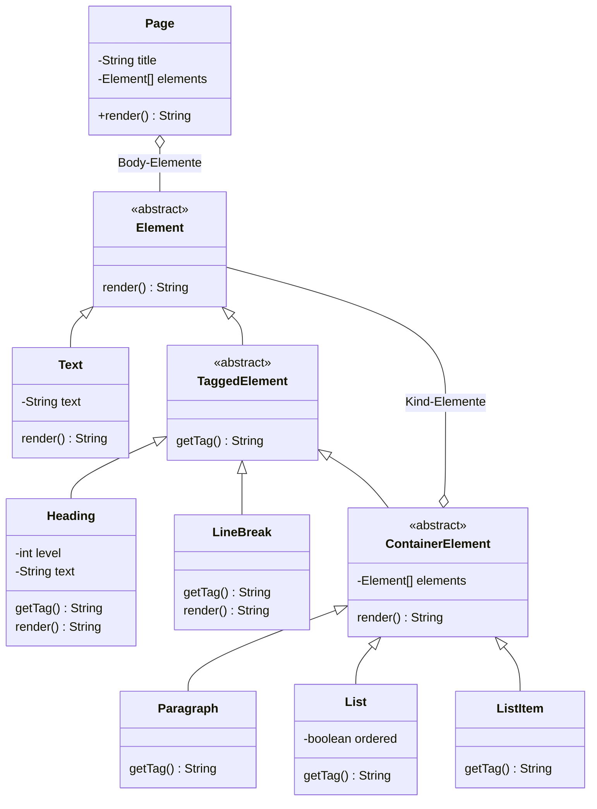

# HTML-Renderer

Eine kleine Java-Klassenbibliothek, mit der HTML-Seiten als Baum von Objekten aufgebaut und anschließend als sauber eingerückter HTML-Text ausgegeben werden.

Entstanden als **Übung 04** in der Lehrveranstaltung *Objektorientiertes Softwaredesign (OOS)* an der FH Hagenberg, WS 2026/27. Thema der Übung: **dynamische Bindung**.

## Worum es geht

Jedes HTML-Element (Überschrift, Absatz, Liste, …) ist eine eigene Klasse. Alle Elemente haben eine gemeinsame Methode `render()`, die den HTML-Text für das jeweilige Element erzeugt. Welche Implementierung von `render()` ausgeführt wird, entscheidet sich erst zur Laufzeit anhand des tatsächlichen Objekttyps – das ist dynamische Bindung.

Ein Absatz muss also nicht wissen, ob er Text, eine Liste oder einen Zeilenumbruch enthält. Er ruft einfach `render()` auf jedem Kind-Element auf, und jedes Element liefert seinen eigenen HTML-Code.

## Beispiel

Seiten werden über die statischen Fabrikmethoden der Klasse `HTML` aufgebaut:

```java
import static at.fhooe.sail.oos.ex04.html.HTML.*;

Page page = page("Meine Seite",
        h1("Willkommen"),
        para(text("Ein Absatz mit einer Liste:"),
             ul(item(text("Erster Punkt")),
                item(text("Zweiter Punkt")))),
        br(),
        text("Ende"));

String html = page.render();
```

Ergebnis:

```html
<html>
  <head>
    <title>Meine Seite</title>
  </head>
  <body>
    <h1>Willkommen</h1>
    <p>
      Ein Absatz mit einer Liste:
      <ul>
        <li>
          Erster Punkt
        </li>
        <li>
          Zweiter Punkt
        </li>
      </ul>
    </p>
    <br/>
    Ende
  </body>
</html>
```

## Unterstützte Elemente

| Methode in `HTML`   | Klasse      | Ausgabe                  |
|---------------------|-------------|--------------------------|
| `page(title, ...)`  | `Page`      | `<html>`, `<head>`, `<title>`, `<body>` |
| `text(s)`           | `Text`      | reiner Text              |
| `h1(s)` … `h3(s)`   | `Heading`   | `<h1>` … `<h3>`          |
| `para(...)`         | `Paragraph` | `<p> … </p>`             |
| `ul(...)`           | `List`      | `<ul> … </ul>`           |
| `ol(...)`           | `List`      | `<ol> … </ol>`           |
| `item(...)`         | `ListItem`  | `<li> … </li>`           |
| `br()`              | `LineBreak` | `<br/>`                  |

`Heading` unterstützt intern die Ebenen 1 bis 6; die Klasse `HTML` bietet Methoden für die Ebenen 1 bis 3.

## Klassenhierarchie



Die zentralen Ideen:

- **`Element`** ist die abstrakte Basisklasse und definiert nur `render()`.
- **`TaggedElement`** ergänzt die abstrakte Methode `getTag()` für alle Elemente mit HTML-Tag.
- **`ContainerElement`** implementiert `render()` einmal für alle Elemente mit Kind-Elementen: öffnender Tag, eingerückte Kinder, schließender Tag. Den konkreten Tag liefern die Unterklassen über `getTag()`. `Paragraph`, `List` und `ListItem` müssen deshalb nur noch `getTag()` überschreiben.
- **`Page`** ist kein `Element`, sondern der Rahmen der gesamten Seite.
- Die Einrückung um zwei Leerzeichen pro Ebene übernimmt `Utils.indentLines()`. Da jedes Container-Element seine Kinder einrückt, entsteht die verschachtelte Einrückung automatisch.

## Projektstruktur

```
HTMLRenderer/
├── src/at/fhooe/sail/oos/ex04/
│   ├── app/
│   │   └── HTMLApp.java          Hauptprogramm, baut eine Beispielseite
│   └── html/
│       ├── HTML.java             statische Fabrikmethoden
│       ├── Utils.java            Hilfsmethode zum Einrücken
│       ├── Page.java
│       ├── Element.java
│       ├── TaggedElement.java
│       ├── ContainerElement.java
│       ├── Text.java
│       ├── Heading.java
│       ├── LineBreak.java
│       ├── Paragraph.java
│       ├── List.java
│       └── ListItem.java
└── page.html                     von HTMLApp erzeugte Beispielseite
```

## Voraussetzungen

- **JDK 25** oder neuer. Das Projekt nutzt Sprachfeatures, die erst ab Java 25 final sind:
  - vereinfachte `main`-Methode ohne `String[] args` und die Klasse `IO` (`HTMLApp`)
  - Anweisungen vor dem `super(...)`-Aufruf im Konstruktor (`List`)
- IntelliJ IDEA (empfohlen, Projektdateien sind enthalten)

## Ausführen

**In IntelliJ IDEA:**
1. Projekt öffnen.
2. `HTMLApp` öffnen und über den grünen Pfeil neben `main` starten.

**Über die Kommandozeile** (im Projektordner):

```bash
# macOS / Linux
javac -d out $(find src -name "*.java")
java -cp out at.fhooe.sail.oos.ex04.app.HTMLApp
```

```powershell
# Windows PowerShell
javac -d out (Get-ChildItem -Recurse src -Filter *.java).FullName
java -cp out at.fhooe.sail.oos.ex04.app.HTMLApp
```

Das Programm gibt das HTML in der Konsole aus und schreibt es zusätzlich in die Datei `page.html` im aktuellen Arbeitsverzeichnis.

## Eigene Arbeit und Vorgaben

Das Codegerüst wurde im Rahmen der Lehrveranstaltung bereitgestellt: die Klassen `HTML`, `Utils` und `HTMLApp` sowie die übrigen Klassen mit leeren Konstruktoren.

Selbst umgesetzt wurden:
- die Vererbungshierarchie (`extends`) laut Klassendiagramm
- die Felder und Konstruktoren der Element-Klassen
- die Implementierungen von `render()` und `getTag()` in allen Element-Klassen
- die Methode `Page.render()`

## Autor

Eric Keplinger, FH Hagenberg
